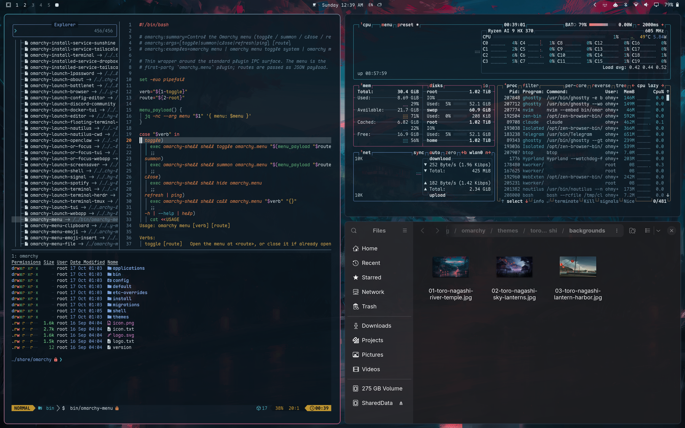

# Toro Nagashi

A theme for [Omarchy](https://omarchy.org).

```
Toro Nagashi — a dark theme drawn from a painting of a mountain temple at
dusk: paper lanterns along a stone path, their light running red down a
river, crimson maple leaves overhead, snow on the far peak catching the last
rose-coloured light under a deep teal sky.

Surfaces are the night forest itself, the navy-teal sampled at #0F1B25,
kept blue rather than neutral. Text is the pale mist of the robe and sky
haze. The accent is the lantern light: the one warm thing in a cold scene.

Hues sampled from the painting: lantern paper #DC5458 (red), lantern core
#FD9567 (orange), snowcap rose #E29098 (bright red), sky teal #348597
(cyan), slate mountain shadow #57768B (muted, and blue, rotated off cyan),
maple leaves #601D39 / #5D324A (magenta), temple wood and stone steps
(brown). The painting has no true green or yellow — its "greens" are all
teal — so green is a jade moss set well away from the teal, and yellow is
the candle flame inside the lanterns.

Lightness is solved in OKLCH against `lighter_background`, the lightest
surface any colour lands on, taking the darkest value that clears the
target so colours stay rich. Every ANSI colour clears 6.0:1 (brown, kept
dim on purpose, 4.6:1), bright variants clear 9.5:1, and foregrounds run
6.5:1 to 13.8:1. No two different hues are closer than 15.8 CIEDE2000, and
each bright sits 11+ from its normal, so nothing blends into a neighbour.
```



## Install

Clone the repo and symlink it into Omarchy's themes:

```bash
git clone https://github.com/Sothcheat/omarchy-toro-nagashi-theme ~/.local/share/omarchy-themes/toro-nagashi
ln -s ~/.local/share/omarchy-themes/toro-nagashi ~/.config/omarchy/themes/toro-nagashi
omarchy theme set "Toro Nagashi"
```

`omarchy theme install` works too, but Omarchy drops a cloned theme's Lua files, so you would lose `hyprland.lua` (border, see-through terminals) and `neovim.lua` (the tuned syntax). A symlinked theme counts as your own copy and keeps them. Update with `git pull` in the clone.

## Contents

Omarchy generates every app's theme from `colors.toml`; the theme ships its own version of these:

- `hyprland.lua`: the teal-to-maple window border and slightly see-through terminals.
- `shell.toml`: bar, menus, notifications and lock screen. Lantern red is kept for errors and alerts; selections use the sky teal.
- `neovim.lua`: aether with the shared editor syntax (below).
- `btop.theme`: graphs run from sky teal to lantern red; each panel outline has its own dimmed colour.
- `icons.theme`: Yaru-prussiangreen-dark, a teal to match the borders.
- `unlock.png`: a glowing torii gate for the boot screen. Apply it with `omarchy-plymouth-set-by-theme toro-nagashi`.
- `preview.png`, `preview-unlock.png`: the theme picker images.
- `backgrounds/`: the river temple painting, sky lanterns rising over a lake ([UHDPaper #6015s](https://www.uhdpaper.com/search?q=lantern&by-date=true)), and red paper lanterns strung over a summer harbour ([Wallhaven 6kkl86](https://wallhaven.cc/w/6kkl86)). Cycle them with `omarchy theme bg next`.

### Editors

`editors/build.py` builds matching VS Code and Zed themes from `colors.toml`; Neovim uses the same mapping. Syntax follows One Monokai's structure, where every role has its own hue:

| Role | Colour |
| --- | --- |
| Keywords, operators, tags | lantern red |
| Declaration words (`function`, `class`, `const`), constants, built-in types | sky teal |
| Functions, attributes | jade |
| Classes, types, modules | slate blue |
| Strings | candle gold |
| Numbers, template `${}` | maple magenta |
| Parameters | lantern orange, italic |
| `this` / `self` | lantern red, italic |
| Comments | slate, italic |

- **VS Code:** `editors/vscode/` is a ready extension. Zip it as a `.vsix` (see the files inside) or copy the folder to `~/.vscode/extensions/ohmylucifer.toro-nagashi-theme-1.0.0`, then pick "Toro Nagashi" with Ctrl+K Ctrl+T.
- **Zed:** copy `editors/zed/toro-nagashi.json` to `~/.config/zed/themes/` and pick "Toro Nagashi" in the theme selector.
- **Telegram Desktop:** `editors/telegram/toro-nagashi.tdesktop-theme` is Telegram's night theme recoloured by role, with the painting as chat background (`editors/telegram.py` rebuilds it). Send the file to Saved Messages, tap it, and choose Apply.

### Extras that need a hook

Omarchy doesn't theme these apps, so the theme ships a file for each and `hooks/` has a `theme-set` hook that puts it in place on every theme change (themes without the file get the app's default back):

| File | Hook | One-time setup |
| --- | --- | --- |
| `lazygit.yml` | `hooks/lazygit` | `export LG_CONFIG_FILE="$HOME/.config/lazygit/config.yml,$HOME/.config/lazygit/theme.yml"` in `~/.config/uwsm/env` and `~/.bashrc` |
| `zen.css` (Zen Browser) | `hooks/zen-theme` | none; the hook enables `userChrome.css` itself. Restart Zen after a theme change. |
| `fastfetch-logo.txt` (a torii over water) | `hooks/fastfetch-logo` | point `logo.source` in `~/.config/fastfetch/config.jsonc` at `~/.config/fastfetch/logo.txt`, with colours `{ "1": "red", "2": "cyan", "3": "green" }` |
| `gtk-accent.theme` (teal accent for Nautilus and GTK4 apps) | `hooks/gtk-accent` | none |

Install a hook with `omarchy hook install theme-set hooks/<name>`, then re-apply the theme.
